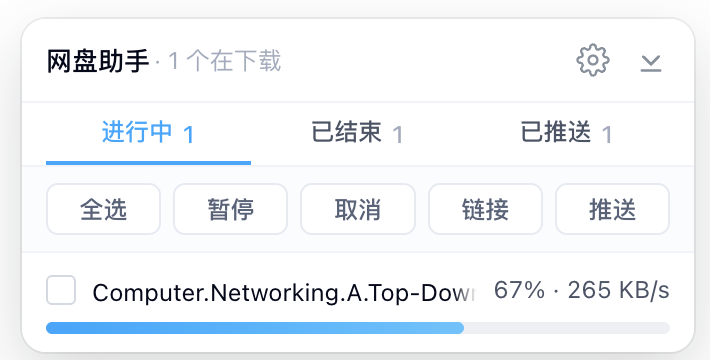
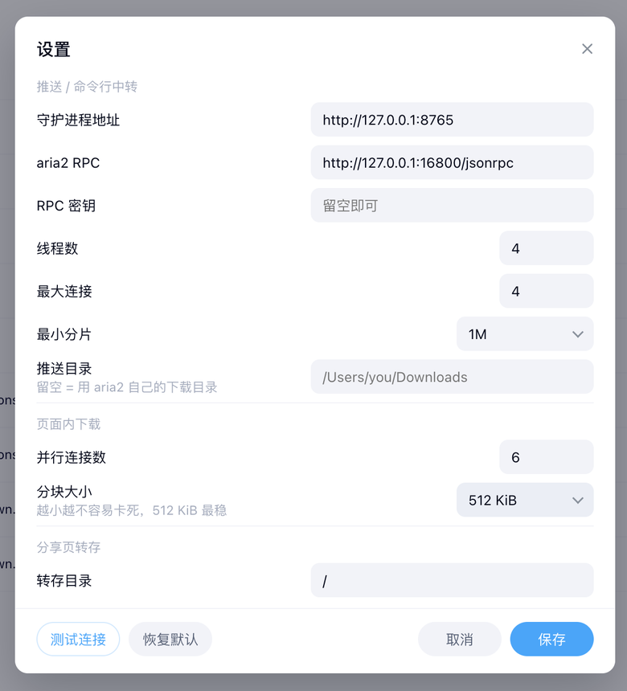

# 网盘助手 · 手册

在网盘页面点击原有的「下载」按钮，脚本即以客户端身份按块取回文件，不再弹出「文件超过 50MB，请使用客户端」。需要交给命令行时，可将链接推送到本机 aria2。

- 用户脚本 `baidu_pan_direct.user.js` **v2.9.50**（Violentmonkey，即暴力猴；亦可运行于 Tampermonkey）
- 本机守护进程 `bpd_daemon.py` **v1.6.0**（可选，仅使用标准库，只为「推送」与「复制链接」而存在）
- 配套脚本：`baidu_epub_dlink.py`（命令行下载，不依赖浏览器）、`bpd_speedtest.py`（测量账号真实吞吐）

安装方法见 [`README.md`](README.md)；本文说明界面、原理、接口与排错。

---

## 1. 使用

### 1.1 行内下载与推送

点击文件行上的下载图标，图标外圈随即出现进度环，无需移动鼠标即可看到百分比；再次点击为暂停或继续。其右侧的**纸飞机**图标可直接推送给 aria2，不创建浏览器任务，也不占用内存（文件夹没有该图标）。

这两个图标依照原生按钮的几何尺寸与配色制作（同格宽、同间距、同 16px、同色），因此与原按钮并无二致。


### 1.2 悬停浮条

鼠标停在进度环上（或停在面板中的任务行上），旁边会浮出四个图标：


| 按钮 | 作用 |
| --- | --- |
| 暂停 / 继续 | 停止发送新块，已下载的块保留 |
| 取消 | 丢弃任务：行内图标复原，任务移至「已结束」；已转存的副本保留在转存目录 |
| 复制链接 | 复制一条 aria2 可直接使用的链接（经本机 `/proxy`）；**按住 ⌥ 则复制整段 curl 分块命令** |
| 推送 | 通过 RPC 推送给本机 aria2；成功后任务移至「已推送」，页面侧立即停止 |

### 1.3 网盘助手面板

面板常驻右下角，没有任务时亦显示。标题栏右侧有两个按钮：齿轮进入设置，另一个用于收起。



**收起时整块面板缩成右下角的小圆钮**（收缩方向即圆钮所在的角），再次点击圆钮展开。收起期间若有任务在运行，圆钮外圈会有呼吸动画，展开即可看到进度详情。收起状态只保存在内存中，刷新页面后始终为展开。


三个标签页：

| 标签页 | 内容 | 底部工具条 |
| --- | --- | --- |
| 进行中 | 正在下载、已暂停、正在获取直链、失败的任务 | 全选 / 暂停·继续 / 取消 / 链接 / 推送 |
| 已结束 | 已完成与已取消的任务（按时间倒序） | 清空 |
| 已推送 | 已交给 aria2 的文件 | 清空 |

- 工具条的作用范围：有勾选时只作用于勾选项，无勾选时作用于所有未完成任务。
- 失败的任务行尾有 ✕，点击即直接丢弃，不进入历史；点击「取消」才会进入「已结束」。下载完成的任务自动移入「已结束」。
- 历史各保留最多 60 条，保存在 GM 存储中，刷新页面后仍然存在。
- 有新任务时面板会自动展开并切换到「进行中」：可以收起，但不能让人「点了下载却看不到」。

### 1.4 批量推送

使用网盘**自身的**勾选框选择文件，顶部工具条「下载」旁即多出一个纸飞机图标（带「推送」二字），点击后选中的文件全部取得直链并推送给 aria2。它与面板内的勾选框作用不同：后者只作用于面板中的任务。


### 1.5 分享页（`pan.baidu.com/s/...`）

分享页同样支持行内下载与推送，按钮样式与分享页自身的按钮一致。分享页的文件无法直接下载，两种方式都需要先**转存**到你的网盘（目录见设置中的「转存目录」，默认为根目录），之后按自有文件处理。

**不会堆积副本**：转存前脚本会在目标目录中查找相同内容（大小相同，且忽略 slice 标记位后 md5 相同），找到则直接使用，不再发起转存。（百度自身不做内容去重，同名文件只会被重命名为 `(1)(2)(3)`。）

**副本一律不会自动删除**，无论下载完成、取消还是失败。`/api/filemanager?opera=delete` 在本账号上恒返回 `errno=132`；去重命中时那份文件本来就在你的网盘里，删它等于删掉你自己的文件。因此脚本只告诉你副本落在哪个目录，删与不删由你决定。

### 1.6 Violentmonkey 菜单

设置… / 转存目录 / 推送地址 / 手动输入 fs_id 下载 / 自检（用当前目录中最大的文件试一遍）/ 版本。

### 1.7 是否需要运行本机守护进程

不需要。它只是一个**可选的本地中转**：

| 操作 | 是否需要守护进程 | 原因 |
| --- | --- | --- |
| 在页面内点击「下载」，由浏览器直接保存 | **不需要** | 全程使用 `GM_xmlhttpRequest` 携带客户端 UA 发送闭合 Range |
| 复制直链 / 复制 `curl` 分块命令 | **不需要** | 直链由页面自行取得，命令中自带 4 MiB 闭合 Range |
| 推送不超过 4 MiB 的文件 | **不需要** | 扩展级请求可直接访问 `127.0.0.1` 的 RPC 接口 |
| 推送超过 4 MiB 的文件 | **需要** | aria2 发送开放式 `bytes=S-`，必然返回 403，需要有人改写成 4 MiB 闭合块 |

守护进程只有一个文件，不依赖第三方库：`python3 bpd_daemon.py` 启动，`pkill -f bpd_daemon.py` 停止，页面功能不受影响。

---

## 2. 设置项

齿轮 → 设置，全部设置保存在 GM 存储的 `bpd_cfg` 键中。默认值即「本机守护进程 + 本机 aria2」，安装后无需修改即可使用。



| 设置 | 键 | 默认 | 说明 |
| --- | --- | --- | --- |
| 守护进程地址 | `daemon` | `http://127.0.0.1:8765` | 「推送」与「复制链接」都经它转发 |
| aria2 RPC | `rpc` | `http://127.0.0.1:16800/jsonrpc` | Motrix 默认为 16800 |
| RPC 密钥 | `secret` | 空 | 仅在 aria2 加了 `--rpc-secret` 时需要填写 |
| 线程数 | `split` | 4 | aria2 的 `-x` / `-s` |
| 最大连接 | `conn` | 4 | `max-connection-per-server` |
| 最小分片 | `minSplit` | `1M` | `min-split-size` |
| 推送目录 | `ariaDir` | 空 | 留空则使用 aria2 自身的目录 |
| 并行连接数 | `cap` | 6 | 页面内同时发出几个 Range（1–24） |
| 分块大小 | `chunk` | 512 KiB | 页面内每块的字节数（256K / 512K / 1M / 2M） |
| 转存目录 | `shareDir` | `/` | 分享页文件先落到哪个目录（须已存在） |

每项说明默认收起，鼠标停在该行时才显示。所有设置立即生效，**分块大小除外**：它在新建任务时固定，中途修改不会作用于已运行的任务（偏移网格一旦变化，拼接出的文件必然损坏）。

---

## 3. 为什么能绕过那道弹窗

1. **网页端接口已受限**：`/api/sharedownload` 对大于 50MB 的文件返回一段网页中没有解密逻辑的密文；`/api/download` 对大于 50MB 的文件签发 `dstime` 回拨、1 小时后过期的直链；`/api/filemetas` 提供的预览链在 `d.pcs` 一律返回 `31362`。在前端修改参数没有作用。
2. **CDN 层有两道限制**（这才是可行之处）：
   - 按**单次请求返回的字节数**计数：`Range: bytes=0-4194303` 返回 206；`bytes=0-8388607`、`bytes=0-`、HEAD、不带 Range 均返回 403 `{"error_code":31326}`。
   - 校验**请求身份**：`netdisk;...` 客户端 UA 返回 206，普通 Chrome UA 返回 403。

因此做法只有两步：**使用客户端 UA 发送不超过 4 MiB 的闭合 Range，再将 N 块拼成完整文件。**

### 3.1 页面内的流程

```
点击下载 → 拦截原生点击
  → /api/list（同域 fetch，携带你的 cookie）取得 fs_id 与文件大小
  → /api/filemetas?dlink=1 取得 PCS 路径
  → GM_xmlhttpRequest 以客户端 UA 请求 pcs.baidu.com，换取 302 直链
  → 按 512 KiB 闭合 Range 并发（默认 6）取回分块，支持暂停与续传
  → 拼接为 Blob → <a download> 保存
```

必须使用 `GM_xmlhttpRequest` 的原因：网页中的 `fetch` 无法修改 `User-Agent`（forbidden header），而 UA 正是通行凭证。

### 3.2 为什么 aria2 需要经过本机 `/proxy`

aria2 在收尾与探测阶段必定发送**开放式** Range（`bytes=S-`），遇到「只接受闭合 Range」的规则即返回 403。`/proxy` 会把客户端的任意 Range 拆成 4 MiB 闭合块串流返回（206 + `Content-Range` + `Content-Length`，HEAD 返回总长度），对 aria2 与 IDM 而言就是一个普通的可续传地址。

同时解决第二个问题：https 页面直接 `fetch('http://127.0.0.1:16800/jsonrpc')` 会被 Chrome 的 Private Network Access 拦截（aria2 不返回预检头），因此页面只与 `127.0.0.1:8765` 通信，由守护进程转发给 aria2。

### 3.3 cookie：脚本不接触

| 步骤 | 使用何种身份 | 是否需要手工提供 cookie |
| --- | --- | --- |
| 列目录 / 取元信息 `/api/*` | 同域 `fetch(credentials:'include')` | 不需要，浏览器自带 |
| 换取直链 `pcs.baidu.com` | `GM_xmlhttpRequest`，`anonymous:false` | 不需要，Violentmonkey 自动携带 `*.baidu.com` |
| 下载文件 `*.baidupcs.com` | 仅需 URL 中的签名与客户端 UA | 不需要 |

更换账号或浏览器均自动生效。`~/.baidu_pan_cookie` 仅由命令行下载器（`POST /start`）使用。

---

## 4. 速度：慢与脚本无关

免费账号的限速发生在账号级：单连接稳态约 72 KB/s，开启 2/4/6/8 个连接后合计均在 100–160 KB/s 之间，连接数只影响抗抖动，不影响上限。会员账号可达 MB/s 级。

可调整的只有三点：更换为会员账号；**不要**让页面内下载与 aria2 同时运行（共用一份配额，会互相抢占）；或更换来源。如需自行测量：`python3 bpd_speedtest.py --file /图书资源/foo.epub`。

---

## 5. 故障排查

| 症状 | 原因与处理 |
| --- | --- |
| 下载图标没有变成圆环 | 脚本未启用，或当前页面不属于 `pan.baidu.com/disk/*`、`/s/*`。可在控制台查看 `__bpd.ver` |
| 点击后没有反应，也没有任务 | 浏览器拦截了「多文件下载」或该站点的自动下载，查看地址栏右侧的图标 |
| 进度长时间停在 0% | 分块过大而网络较慢，超时后未重试成功。将分块改回 512 KiB，并行连接数降到 4 |
| 提示「客户端身份都被 CDN 拒了」 | 三个客户端 UA 均返回 403：直链签名已过期，或文件已被移走。刷新页面后重试 |
| 大文件点击保存没有反应 | 行内下载会把整份文件拼接在内存中，几十 GB 的文件请改用推送 |
| 面板不见了 | 可能已收起：点击右下角的小圆钮即可展开 |
| 推送提示「本机守护进程没起」 | 启动 `bpd_daemon.py`，或改用「复制链接」取得 curl 命令 |
| 推送提示「连不上 aria2 RPC」 | aria2 未启动、端口不对，或 Motrix 未开启 RPC（需在设置中手动打开） |
| 设置中「测试连接」失败 | 原因同上，它请求的是 `GET <守护进程>/ping` |
| aria2 中任务报 403 / 31326 | 推送被改成了 `mode=direct`：直链交给 aria2 必然返回 403，改回 proxy 模式 |
| 复制出的链接打开报 `31362` | 复制到的是 CDN 原链（签名已过期或未经过 `/proxy`），重新复制一次 |
| 找不到行内图标 | 百度改版了 DOM：先试用菜单中的「自检」，仍不行则需更新选择器 |
| 转存目录中多出副本 | 脚本一律不删副本（删除接口在本账号上不可用），手动删除即可 |
| 推送后 aria2 立即完成，但本地没有文件 | aria2 目录中已有同名同长度的文件（`-c` 视为已完成），更换「推送目录」后重试 |
| 推送时提示「复用网盘里已有的同名同内容文件」 | 正常：文件已在转存目录中，不会重复创建副本 |

---

## 6. 三种运行环境

| 环境 | 行内下载 | 复制链接 / 推送 | 说明 |
| --- | --- | --- | --- |
| 仅安装脚本 | ✅ | ❌ | 主要功能全部在浏览器中完成 |
| 脚本 + 守护进程 | ✅ | ✅ | macOS 与 Linux 通常自带 Python 3，一条命令即可启动 |
| Windows 无 Python | ✅ | ❌ | 降级：复制链接改为复制 curl 分块命令（需要 Git Bash 或 WSL） |

守护进程未运行时，脚本会自动降级（启动时请求 `GET /ping`，此后每 30 秒一次）：「复制链接」不会退化为一条必然返回 403 的直链，而是给出不依赖第三方工具的 bash 命令——每块对应一个文件、已下载的块自动跳过（重跑即续传）、`curl -fsS` 失败不会留下 0 字节文件、拼接完成后核对字节数。

---

## 7. 维护者速查

### 7.1 关键常量（`baidu_pan_direct.user.js` 头部）

| 名字 | 值 | 意义 |
| --- | --- | --- |
| `CHUNK` | `512 * 1024` | 页面内的默认块大小；4 MiB 是 CDN 的硬性上限 |
| `CLIENT_UA` | 三条 `netdisk;...` | 按顺序尝试，全部返回 403 才报错 |
| `DAEMON` | `http://127.0.0.1:8765` | 守护进程的默认地址 |
| `REFERER` | `https://pan.baidu.com/disk/main` | 换取直链时携带的 Referer（缺少会被 CDN 拒绝） |

### 7.2 调试出口 `window.__bpd`

`ver` `tasks` `panel` `sel` `cap` `fold(bool)` `folded()`｜`probe(path)` `metaOf(fsid)` `listDir()`
`pcsUrl(path)` `download(fsid)` `push(task)` `quickPush([fsid])` `resolve(fsid)`｜`link(t)` `cmd(t)` `curl(t)`｜
`hist` `tab(name)` `curTab()`｜`sharePush([fsid])` `findSame(dir,smeta)` `shareFileMeta(fsid)`｜
`cfg()` `saveCfg(patch)` `openCfg()` `ping()` `daemonOk()`。

### 7.3 任务状态

`probe`（正在获取直链）/ `run` / `pause`（分块保留）/ `done` / `err`，五个状态仅存在于「进行中」。取消与推送成功都会把任务从 `TASKS` 中移除（`dropTask`），再向 `HIST.cancel` / `HIST.push` 记录一条。✕ 只对 `done` / `err` 显示，点击即丢弃，不进入历史。

### 7.4 面板的收起

`setFold(bool)` 是唯一出口：给 `.bpd-panel` 添加 `.is-hide`（`opacity` + `scale(.34)`，`transform-origin:100% 100%`，朝右下角收缩），并给小圆钮 `.bpd-fab` 添加 `.on`，两侧过渡时长对齐即可。状态只保存在内存中（`FOLDED`），不写入存储——若记忆为收起，下次进入页面会一片空白。`renderPanel()` 在收起时直接返回，避免每 400ms 的重绘与动画争夺帧；但小圆钮的 `.is-run`（呼吸环）在此之前更新，因此收起时也能看出正在下载。

### 7.5 守护进程接口（v1.6.0）

| 接口 | 说明 |
| --- | --- |
| `GET /ping` | 存活状态、版本、aria2 状态、输出目录与 token |
| `GET /aria` | aria2 的 `getVersion` + `getGlobalStat` + `tellActive` |
| `GET /proxy?u=&fn=` | 4 MiB 闭合块中转（支持 206 / HEAD / 断点续传） |
| `POST /push` | `{items:[{url,name,size,ua,fsid}], rpc?, mode?}` → 逐条调用 `aria2.addUri` |
| `POST /start` | 调用命令行下载器（不使用 aria2，自行下载） |
| `GET /jobs` `GET /log` | 任务与日志（`/log` 只读取 `BPD_LOGDIR` 中的文件） |

三道门（每个请求都要经过）：

| 检查 | 规则 | 拦截什么 |
| --- | --- | --- |
| `Host` | 必须是 `127.0.0.1` / `localhost` / `[::1]` | DNS rebinding：外部域名解析到 127.0.0.1 后借你的身份发起请求 |
| `Origin` | 只接受 `https://pan.baidu.com` / `https://yun.baidu.com`（无 Origin 的本机工具放行） | 浏览器中其他页面读取 `/ping`、发送 `/push` |
| `X-BPD-Token` | `POST /push`、`POST /start` 必须携带；token 每次启动随机，由 `GET /ping` 返回 | 本机没有 token 的进程随意推送任务 |

`/aria` 与 `/push` 的 `rpc` 只接受回环地址；`/proxy` 只代取 `BPD_PROXY_HOSTS` 中的域名后缀；`/start` 的文件名只取 basename，落点必须在 `BPD_OUTDIR` 之内。

环境变量：`BPD_PORT`（8765）、`BPD_ARIA`（`http://127.0.0.1:16800/jsonrpc`）、`BPD_ARIA_SECRET`、`BPD_OUTDIR`（`~/Downloads`）、`BPD_WORKER`、`BPD_LOGDIR`（`/tmp/bpd_daemon`）、`BPD_TOKEN`（默认每次启动随机）、`BPD_AUTH`（默认 1，设为 0 关闭 token 校验）、`BPD_PROXY_HOSTS`。

### 7.6 配套脚本

```bash
python3 bpd_speedtest.py --file /图书资源/foo.epub                          # 测量该账号的真实吞吐
python3 bpd_speedtest.py --file /图书资源/foo.epub --chunk 4M --conns 1,4,8 --samples 3
python3 baidu_epub_dlink.py --path /图书资源/foo.epub                       # 不使用浏览器，分块下载完成
python3 baidu_epub_dlink.py --path /图书资源/foo.epub --probe               # 仅查看 Range 放行表
```

---

## 8. 适用范围与边界

- 仅作用于 `pan.baidu.com/disk/*` 与 `pan.baidu.com/s/*`。
- 分享页查重仅对**当前页 `yunData.file_list` 中带有元信息**的文件生效；翻页或搜索结果中选择的文件没有 md5，只能直接转存。
- 全部能力都建立在「CDN 只接受不超过 4 MiB 的闭合 Range 且认可客户端 UA」这一规则上。百度一旦修改，脚本必须同步更新。
- 行内下载会把整份文件拼接为 Blob 保存在内存中；几百 MB 以上建议使用推送。
- `/proxy` 只代取百度 CDN 的域名后缀（`BPD_PROXY_HOSTS`），并非开放中转。
- 脚本不调用任何删除接口：`/api/filemanager?opera=delete` 在本账号上恒返回 `errno=132`，且去重命中时那份文件本来就在用户网盘里，误删的会是用户自己的文件。
- 免费账号的限速是服务端行为，脚本无法绕过（见 §4）。
