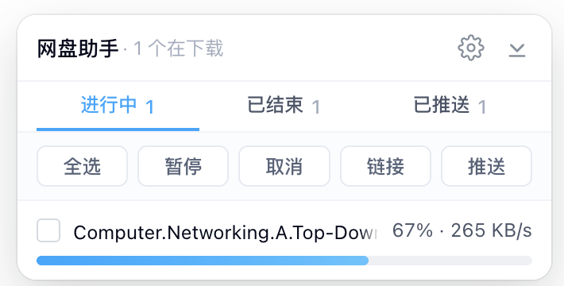

# 网盘助手（Pan-Helper）

**让百度网盘网页端真正把文件下载下来。**

点击网盘原有的「下载」按钮，脚本改用客户端身份、按不超过 4 MiB 分块取回真实文件，不再弹出「文件超过 50 MB，请使用百度网盘客户端」。进度显示为原生图标外的一圈细环，鼠标悬停可暂停、取消、复制链接或推送到本机 aria2。右下角是「网盘助手」面板：点击收起缩成小圆钮，再点一次展开。


**需要先说明：它不能提速。** 免费账号的限速由服务端按账号执行，脚本只解决「网页端能否下载」，不解决「下载得快不快」。


## 功能

- **接管原生下载**：`pan.baidu.com/disk/*` 与分享页 `/s/*` 上的下载图标，点击即走直链下载。图标、悬停效果与气泡沿用网盘自身的样式，不额外添加自绘按钮。支持分块、暂停、断点续传，并按文件大小与 md5 校验完整性。
- **推送给 aria2**：一键推送后浏览器侧立即停止，线程、续传与保存目录全部交给下载器。
- **网盘助手面板**：「进行中」「已结束」「已推送」三个标签页，可批量暂停、取消、复制链接、推送；点击标题栏的收起按钮，整块面板缩成右下角的小圆钮（有任务运行时小圆钮会呼吸），点击圆钮即可展开。刷新页面后默认展开。
- **分享页**：先转存再下载或推送；转存前按文件大小与 md5 查重，不会堆积一串 `(1)(2)(3)`。
- **命令行下载**：不打开浏览器时，可用命令行分块下载并校验（可选）。



## 安装

1. 安装 [Violentmonkey](https://violentmonkey.github.io/)（推荐）或 Tampermonkey。
2. 把 [`baidu_pan_direct.user.js`](baidu_pan_direct.user.js) 拖进浏览器窗口，或新建脚本并粘贴全文保存。
3. 打开 <https://pan.baidu.com/disk/main>，文件行上的下载图标变为一圈细环，即安装完成。

在控制台执行 `__bpd.ver` 可查看版本号，`__bpd.tasks` 可查看当前任务列表。

## 可选：本机守护进程

**不使用 aria2 就完全不需要它。** 它为「推送」与「复制链接」而存在：脚本手里只是一条百度签名的原始直链，这条链接对 Range 探测、文件名与断点续传都很挑剔；`/proxy` 把它规整成「不超过 4 MiB 的闭合块 + 原始文件名 + 可续传」，任何下载器拿到都能直接使用。

```bash
# 1) 启动一个 aria2 RPC（Motrix 自带 16800；命令行方式：）
aria2c --enable-rpc --rpc-listen-port=16800 --rpc-listen-all=false \
       --dir="$HOME/Downloads" --continue=true --file-allocation=none &

# 2) 启动守护进程（只用标准库，无需 pip）
python3 bpd_daemon.py

# 3) 自检
curl -s 127.0.0.1:8765/ping
```

守护进程未运行时，脚本会自动降级：「复制链接」改为复制一段只依赖 `curl` 的分块命令（每块完成都会回显一行，中断后在同一目录重跑就是续传），「推送」则直接提示未启动。页面内下载不受影响。

## 命令行下载（不打开浏览器）

```bash
python3 chrome_baidu_cookie.py                               # 取得 cookie，写入 ~/.baidu_pan_cookie（权限 600）
python3 baidu_epub_dlink.py --path /书籍/foo.epub            # 分块下载并校验
python3 baidu_epub_dlink.py --path /书籍/foo.epub --probe    # 只打印 Range 放行表，不下载
```

## 设置

设置面板中只有以下几项：守护进程地址、aria2 RPC 与密钥、线程数 / 连接数 / 最小分片、分块大小、转存目录。默认值即「本机守护进程 + 本机 aria2」，安装后无需修改即可使用；全部保存在浏览器的 GM 存储中，修改后立即生效。

## 原理：为什么能绕过那道弹窗

限制都在 CDN，不在前端页面：以 `netdisk;...` 的客户端身份请求时，单次只放行**不超过 4 MiB 的闭合 Range**——`bytes=0-4194303` 返回 206，而 `bytes=0-8388607`、开放式 `bytes=S-`、以及**不带 Range 的普通 GET** 一律返回 `403 {"error_code":31326}`（换成 aria2、浏览器或 curl 的 UA，这四条限制都不成立，实测可以整段流式下载）。因此脚本的做法是：以客户端身份发送 4 MiB 闭合块，再把各块拼成完整文件。浏览器中的 `fetch` 无法修改 `User-Agent`（forbidden header），这就是必须使用 `GM_xmlhttpRequest` 的原因。

## 已知限制

- **不能提速**：免费账号单连接约 72 KB/s，开启 2/4/6/8 个连接后合计也只有 100–160 KB/s，这是账号侧的限速。页面内下载与 aria2 同时运行会互相抢占配额，请勿同时开启。
- 行内下载会把整份文件拼接在内存中，几百 MB 以上请使用推送。
- 仅作用于 `pan.baidu.com/disk/*` 与 `pan.baidu.com/s/*`。
- 分享页查重只对当前页列表中带 md5 的文件生效；翻页或搜索结果中选择的文件只能直接转存。
- 转存产生的副本一律不会自动清理，需要时请自行删除（删除接口在本账号上不可用，脚本也不代为删除，以免误删你网盘里本来就有的文件）。
- 全部能力都建立在「客户端身份下只放行不超过 4 MiB 的闭合 Range」这一条 CDN 规则上；百度一旦修改，脚本必须同步更新。

界面、原理、接口与排错的细节见 [`MANUAL.md`](MANUAL.md)（手册）。

## 安全

- cookie 只写入 `~/.baidu_pan_cookie`（权限 `600`），本仓库**不包含**任何 cookie、token 或签名直链。
- 守护进程只监听 `127.0.0.1`：`Host` 必须是本机地址，`Origin` 只接受网盘页面，写操作还需携带一次一换的 `X-BPD-Token`，因此浏览器中的其他网站既读不到响应，也发不出写请求。
- 直链与账号绑定，泄露等同于把文件交给他人，请勿张贴到公开场合。

## 参与开发

这个仓库按现状发布，不接 PR：觉得哪里不对就 fork 走，随便改，改完自己留着用，不用打招呼。

issue 会看，但不保证回复；报 bug 请带上 `__bpd.ver`、`/ping` 输出、复现步骤、控制台报错。

## 免责声明

本项目与百度公司无关，仅供个人在自己的账号上下载自己有权访问的文件。
使用前请确认你确实有权下载这些文件，并遵守百度网盘的用户协议与当地法律。
因使用本工具造成的账号限制、数据丢失或其他后果，由使用者自行承担。

## 许可

[MIT](LICENSE)

## 文件

```
baidu_pan_direct.user.js   用户脚本（必需，包含全部网页端功能）
bpd_daemon.py              本机守护进程 127.0.0.1:8765（可选：/proxy 中转与 /push 转发）
baidu_epub_dlink.py        命令行下载器（可选，不依赖浏览器）
bpd_speedtest.py           测量账号真实吞吐（可选）
chrome_baidu_cookie.py     从 Chrome 读取网盘 cookie（可选，仅在命令行下载时需要）
MANUAL.md                  手册：界面、原理、接口与排错
docs/                      手册与 README 中的截图
```
